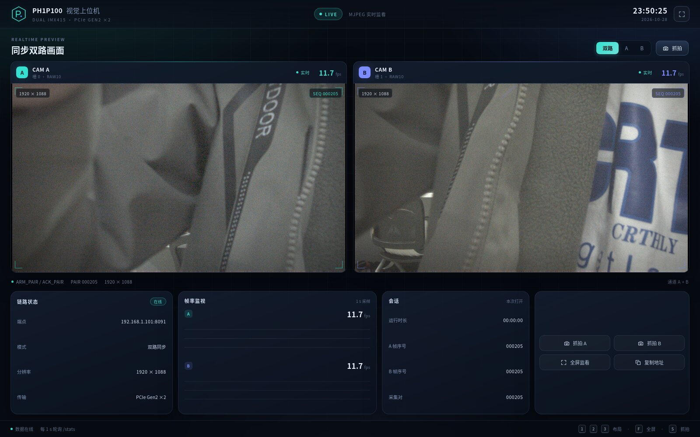

# display-stream —— R10F 取帧 → 彩色 JPEG → HTTP 推流

RK3588 上把安路 PH1P100 EP 送来的相机帧取出、去马赛克/后处理、编成 JPEG，由最小
HTTP 服务推出去（MJPEG 连续流 + 单帧快照）。

> 2026-10-28 状态：当前正式通路是 **1920×1080 ROI、packed RAW10、R10F v1**，
> 一帧传输 **2,592,768 B**（128 B 头 + 2,592,000 B 载荷 + 640 B 尾零）。
> 驱动只创建一个 <code>/dev/ANLOGIC-PCI0_frame</code> 节点，但现在是**两槽**：
> 槽 0=A、槽 1=B。display 新增 <code>--source device-pair</code>，自己写 pair 寄存器、
> 一次 <code>ARM_PAIR/ACK_PAIR</code> 取同一曝光对，输出 A/B/pair 三个视图。

## 快速开始

板上（二进制已交叉编译到 aarch64）：

~~~sh
# 1) 双路实时 1080p：同步先启动，display 自己 pump ARM/ACK
/root/link_ctl sync start -t 5000      # 等 locked=1
/root/display-pair --source device-pair --fps 30 --port 8091

# 想要更顺滑就用 960×540（编码量降到 1/4，帧率翻倍）
/root/display-pair --source device-pair --fps 30 --scale 2 --port 8091

# 浏览器/本机：
curl -o /tmp/a.jpg http://<板子IP>:8091/snapshot_a.jpg
curl -o /tmp/b.jpg http://<板子IP>:8091/snapshot_b.jpg
curl       http://<板子IP>:8091/stats

# 2) 单路 A（兼容旧路径；需要外部 ARM/ACK，或先让驱动 probe 的那次保持）
/root/display-pair --source device --scale 2 --port 18090

# 3) 静态 PGM / 离线 R10F
./display-stream --source pgm --pgm /tmp/f.pgm --auto --scale 2
./display-stream --source r10f --r10f fa.dma --auto --scale 2
~~~

双路模式的 <code>next_pair</code> 在 display 进程内循环，不再需要外部 <code>link_ctl arm/ack</code>。
单路 <code>--source device</code> 仍是“读当前邮箱里的一帧”，不自动 pump。

## 数据链路（当前）

~~~text
IMX415 A/B 4K RAW10
  -> checked CSI-2（ECC/VC/DT/WC/CRC/行数/FS-FE 裁决）
  -> 偶数 ROI 1920x1080（X0=960, Y0=540, SKIP_ROWS=37）
  -> cam_r10f_writer（128B 头 + packed RAW10 + 4KiB 尾零）
  -> DDR3 双缓冲 -> ddr_frame_pusher
  -> PCIe Gen2 x2 Posted MWr -> 主机一致性 DMA 槽
  -> /dev/ANLOGIC-PCI0_frame（两槽：0=A，1=B；pair 门铃 +32/+36）
  -> display --source device-pair：ARM_PAIR -> 等两门铃 -> 两槽 strict
  -> A/B 各自 R10F 解析 -> 5B/4px 解包 -> 去马赛克/后处理 -> JPEG
  -> /stream_a.mjpg + /stream_b.mjpg + /pair（并排页面）
~~~

槽内布局：16 B 槽头 + 112 B pad + R10F（128 B 头 + 2,592,000 B packed + 640 B 尾零）。
槽步长 2,596,864 B；两槽 + mailbox 总分配 5,197,824 B。

## R10F 支持（2026-10-28 修复）

<code>src/r10f.rs</code> 校验 magic/version/header_bytes/format/codec/valid_bits/packing/
width/height/stride/raw_bytes/payload_bytes，并解包 5B/4px：

~~~text
b0=P0[9:2] b1=P1[9:2] b2=P2[9:2] b3=P3[9:2]
b4={P3[1:0],P2[1:0],P1[1:0],P0[1:0]}
8bit 预览 = 每个采样的高 8 位 = b0..b3
~~~

设备源按驱动报的 <code>slot_bytes</code> 读满一槽，再解析；不是 R10F 时才回落旧 8bit 路径。
文件源 <code>--source r10f --r10f f.dma</code> 走同一解析器，用于离线回归。

## 彩色相位：当前安装 A/B 均 RGGB

### 已确证

真实帧 2×2 四个格子的均值（frame A）：

~~~text
(0,0)=31.32  (0,1)=56.72
(1,0)=56.68  (1,1)=35.85
~~~

两条绿对角只差 0.07%，主对角差 13.5% —— 绿在**反对角** (0,1)/(1,0)。
马赛克里只有绿占两格，所以相位只可能是 **RGGB 或 BGGR**；
<code>GBRG</code>/<code>GRBG</code>（绿在主对角）会出品红/绿棋盘，已排除。

### 为什么取 RGGB

- A/B 两路看同一间办公室；只有 RGGB 让两边告示牌都还原成**黄色**，
  BGGR 会把它们都变蓝。同一块牌子不可能既黄又蓝，这是当前最强的一组同场景对照。
- 用户对 <code>--bayer rggb</code> 的 A 路结果确认为“有点对”。
- R10F 头 0x28 写 3(GBRG) 是 <code>SRC_BAYER_PHASE=0</code> 占位按 ROI 奇偶推导的，
  <strong>不是测量值</strong>；不要拿它当相位。

### 仍然存在的风险

早期 BGGR 结论来自 180° 翻转的旧预览/另一套安装；如果当前模组实际是倒装，R/B 会互换。
换模组、改支架、改 MIPI 走线、改 ROI 奇偶（X0/Y0/SKIP_ROWS）后必须用**已知色卡**重测。
命令行可随时覆盖：

~~~sh
display-stream --source r10f --r10f fa.dma --bayer rggb --auto
display-stream --source r10f --r10f fb.dma --bayer bggr --auto
~~~

<code>--bayer auto</code> 当前解析为 RGGB；它保留成独立名字，是为了以后换模组只改一处。

## 后处理（<code>--auto</code>，device/r10f 默认开）

| 项 | 预设 | 选项 | 说明 |
| --- | --- | --- | --- |
| 黑电平 | 12 | <code>--black 0..64</code> | IMX415 10bit pedestal 50 截成 8 位 = 12 |
| gamma | 2.2 | <code>--gamma 1.0..4.0</code> | 线性 RAW -> 显示域 |
| AE | 目标 100 | <code>--ae 0..250</code> | 只提亮（gain >= 1），不压暗正常曝光帧 |
| AWB | 灰世界 | <code>--awb</code>/<code>--no-awb</code> | 扣黑后、排除 max>=250 的像素，再算 R/B 增益 |

<code>--source device</code> / <code>--source r10f</code> 不给 <code>--auto</code> 也默认按上表开；
<code>--no-auto</code> 可退回原样透传。synthetic/pgm 默认关，仍要显式 <code>--auto</code>。

实现顺序：扣黑 -> 灰世界 AWB -> AE -> gamma LUT -> 高光去饱和 -> 4×4 有序抖动。
高光去饱和只把输出域 max>220 的像素往亮度拉，避免灯管边缘品红/绿边。

**关于“绿衣服不绿”**：这两帧里前景织物与白墙的相机色度几乎相同（差异 <2%）。
任何让白墙变白全局 AWB 都会把它还原成中性；要强行保留绿色，只能把白墙也染绿，
或做按区域/语义的白平衡。这是当前像素的事实，不是相位错。真要验证请拿已知色卡/
已知颜色物体重拍。

## RKNN YOLO11n 检测与叠加（2026-10-28）

RK3588 三核 NPU 上跑 YOLO11n（COCO 80 类，640×640），检测框/类别/置信度直接画进
MJPEG 和快照。A/B 各一个 RKNN context，默认 A=core0、B=core1；检测 worker 与
JPEG 编码解耦，检测跟不上时覆盖旧任务，不阻塞推流。

~~~sh
# 单次离线验证（不占用设备）
/root/tools/display-detect --source r10f --r10f /tmp/fa.dma --auto --scale 2 \
  --detect --rknn /root/models/yolo11n-640-int8.rknn --port 8094

# 双路实时：需要先停掉其它占用 /dev/ANLOGIC-PCI0_frame 的进程
/root/display-detect --source device-pair --fps 30 --scale 2 \
  --detect --rknn /root/models/yolo11n-640-int8.rknn --port 8091

# 只检测 A 路 / 只看日志不画框
... --detect --detect-side a
... --detect --no-overlay
~~~

模型是 **双输出** <code>boxes [1,4,8400] + scores [1,80,8400]</code>，分开量化。
不要把 Ultralytics 默认的 <code>[1,84,8400]</code> 单输出直接做 int8：框坐标 0..640
的尺度会把 0..1 的类别分数压成 0，框在但永远检测不到目标。模型来源、校验和与
重新生成方法见 <code>models/README.md</code>。

板测（2026-10-28，960×544，双路）：

| 项 | 结果 |
|---|---|
| pair 推流 | **21.9 pair/s**（对照无检测约 23–24） |
| 单路推理 | 约 **40 ms**（INT8，含反量化） |
| 检测提交 | 每路 15 fps 上限，NPU 忙时丢旧任务 |
| 结果 | A 6 框、B 7 框（显示器/椅子/瓶子），框与画面目标对齐 |

已知取舍：INT8 单输出模型不可用（类别全 0），仓库默认用双输出 INT8；FP16 单输出
模型也能出框，但推理约 86 ms，只在没有双输出模型时兜底。

## 构建

前端先构建，Rust 侧用 <code>include_str!</code> 把 <code>web/dist/index.html</code>
嵌进二进制，所以板端不需要 Node、也不依赖外网 CDN：

~~~sh
cd web
pnpm install          # 或 npm install
pnpm build            # 产出单文件 dist/index.html（JS/CSS 全内联）
cd ..
cargo build --release
cargo build --release --target aarch64-unknown-linux-gnu
cargo test
~~~

只改 Rust 不需要重跑前端；改了 <code>web/</code> 必须先 <code>pnpm build</code> 再编 Rust。
开发页面时不用反复编 Rust：

~~~sh
DISPLAY_BOARD=http://<板子IP>:8091 pnpm dev
~~~

Vite 会把 <code>/stats</code>、<code>/stream</code>、<code>/snapshot</code> 代理到板子。

交叉链接器见 <code>.cargo/config.toml</code>（<code>aarch64-linux-gnu-gcc</code>），
产物在 <code>target/aarch64-unknown-linux-gnu/release/display-stream</code>。

## 命令行

~~~text
--source synthetic|pgm|r10f|device|device-pair   数据源，默认 synthetic
--pgm <路径>                         PGM 文件源（P5/P2 灰度）
--r10f <路径>                        R10F 文件源（.dma，从魔数开始）
--device <路径>                      收帧节点，默认 /dev/ANLOGIC-PCI0_frame
--ctrl <路径>                        双路控制节点，默认 /dev/ANLOGIC-PCI0_control
--width/--height                     合成源几何
--fps <1..240>                       推流节奏，默认 15
--quality <1..100>                   JPEG 质量，默认 80
--jpeg-dev <节点>                    硬件 JPEG 编码节点，默认 /dev/video4（存在即启用）
--no-hw-jpeg                         只用软件编码（对比/排查用）
--scale <1|2|4|8>                    编码前降采样；彩色走 CFA binning
--bayer <auto|gray|rggb|bggr|grbg|gbrg>  相位，默认 auto（当前 RGGB）
--auto / --black / --gamma / --ae / --awb / --no-awb  后处理
--port <端口>                        默认 8090
--bind <地址>                        默认 0.0.0.0
--timeout-ms <毫秒>                  设备等帧超时，默认 2000
--detect                            打开 RKNN YOLO11n 检测并叠加（默认关）
--rknn <路径>                       RKNN 模型，默认 /root/models/yolo11n-640-int8.rknn
--conf <0..1>                       置信度阈值，默认 0.25
--nms <0..1>                        NMS IoU 阈值，默认 0.45
--detect-side <both|a|b>            检测哪一路；pair 默认 both，单路默认 a
--detect-fps <1..60>                每路检测提交上限，默认 15
--no-overlay                        只推理/打日志，不画框
~~~

## Web 上位机

> 截图是 <code>--source synthetic</code> 的测试画面；板上是 A/B 实时图像。

<code>/</code> 和 <code>/pair</code> 现在是同一套监控上位机（Vue 3 + Vite，单文件构建）：

- 深色仪表盘：双路画面、通道状态、分辨率 / SEQ / 实时 fps；
- 布局切换（双路 / 仅 A / 仅 B）、单帧抓拍下载、画面全屏；
- 右侧链路状态、帧率曲线（A/B 各 60 个 1 s 采样）、会话计数；
- 单路模式自动隐藏 B 路并禁用相关按钮，不需要两套页面；
- 快捷键：<code>1/2/3</code> 切布局，<code>F</code> 全屏，<code>S</code> 抓拍；
- 断流自动重连（1.5 s 退避），MJPEG 首帧用 <code>naturalWidth</code> 探测，
  兼容不触发 <code>img.load</code> 的浏览器。

帧率由服务端按 <code>publish</code> 间隔测量（2 s 无新帧归零），页面每秒只轮询一次
<code>/stats</code>，不参与编码/取帧。

## HTTP

~~~text
/                上位机；单路/双路自适应
/pair            同一页（兼容旧链接）
/stream_a.mjpg   A 路 MJPEG（旧 /stream.mjpg 同义）
/stream_b.mjpg   B 路 MJPEG
/snapshot_a.jpg  A 路单帧 JPEG
/snapshot_b.jpg  B 路单帧 JPEG
/stats           {"pair":true,"a_seq":N,"b_seq":N,"pair_seq":N,
                  "width":1920,"height":1080,"a_fps":30.0,"b_fps":30.0}
~~~

<code>curl -o a.jpg http://<板子IP>:8091/snapshot_a.jpg</code> 抓一帧；响应头带帧序号/几何。

## 代码位置

~~~text
src/driver.rs        驱动 ABI：ioctl/结构体/mmap/槽读取
src/r10f.rs          R10F 头校验 + packed RAW10 解包
src/source/          synthetic / pgm / r10f_file / device / pair
src/bayer.rs         相位枚举 + 双线性去马赛克 + CFA binning
src/auto.rs          黑电平 / 灰世界 AWB / AE / gamma / 高光去饱和 / 抖动
src/encode.rs        JPEG（灰度 Luma / 彩色 RGB，软件回退）
src/hwjpeg.rs        RK3588 VEPU121 硬件 JPEG（V4L2 M2M，NV12 → JPEG）
src/http.rs store.rs 最小 HTTP 与最新帧共享区（含服务端帧率）
web/                 Vue 3 + Vite 上位机；dist/index.html 由 http.rs 嵌入
~~~

## 硬件 JPEG（默认启用）

板上有 RK3588 的 VEPU121（<code>/dev/video4</code>，hantro-vpu，V4L2 M2M）。
1080p 一帧编码约 **15 ms**，纯 Rust 软件编码约 60 ms，所以默认走硬件；
节点不在（例如在 x86 上开发）或自检不过时自动退回软件编码，只打一行提示。

启动时会用 192×192 纯色帧做一次真编码自检，确认出的是三分量 JPEG 才启用：

~~~text
硬件  ：/dev/video4 可用（VEPU121，NV12 → JPEG）
~~~

跟驱动相关、踩过才知道的几点（都写在 src/hwjpeg.rs 顶部）：

1. **先 S_FMT(CAPTURE, JPEG) 再 S_FMT(OUTPUT, NV12)**。顺序反过来，输出队列的
   REQBUFS 照样成功，但随后 QUERYBUF 一直 EINVAL。
2. NV12 的两个平面是**各自独立 mmap** 的（plane 1 的偏移不等于 plane 0 的长度），
   不能当连续内存用。
3. 驱动会把尺寸向上对齐：宽度最小 96、高度按 16 对齐，**1080 → 1088**。
   多出来的行按最后一行复制，推流头里上报的是真实尺寸 1088。
4. 实测「两个实例各开一次 /dev/video4 并行编码」比单实例串行更慢
   （37 ms/对 vs 29 ms/对），所以 A/B 共用同一个实例，用 Mutex 串起来。

## 已知限制

- 双路源已内置 ARM/ACK pump；单路 <code>--source device</code> 仍是单帧读取，不 pump。
- 取帧与编码已解耦：取帧线程只做 ARM/等门铃/R10F 校验/ACK，A/B 在两核并行编码，队列深度 2。
- 实测（RK3588）：源端 30 pair/s；纯取帧上限约 **30 pair/s**（60 帧/s，PCIe ~155 MB/s）。
- 1080p 彩色：约 **11 pair/s**（每对 ~90 ms：去马赛克 26 + 后处理 21 + RGB→NV12 13 + 硬编码 21）。
- `--scale 2`（960×540）：约 **23~24 pair/s**（每对 ~43 ms），适合实时预览。
- 帧率瓶颈在 CPU 像素处理，不在 PCIe 也不在相机；<code>DISPLAY_DEBUG_TIMING=1</code> 每 5 秒打一行分段耗时。
- 没有 CCM/镜头校正/3A 标定；颜色是“白参考 + 灰世界”级别，不是色彩管理级。
- 只取 RAW10 高 8 位，暗部有量化损失；需要 10/16bit 通路要另改 Frame 类型。
- 去马赛克是双线性，边缘有假彩色；需要 Malvar/边缘自适应可替换 <code>src/bayer.rs</code>。
- R10F 头的 bayer_phase 不可信；换硬件后必须重测相位。
